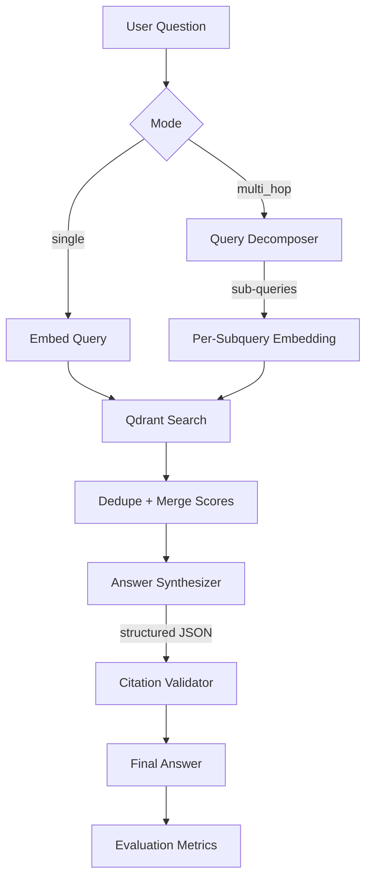

<div align="center">

# 🔬 Verifiable RAG

**A multi-hop RAG system with claim-level citations and a custom evaluation harness for research papers.**

[](https://python.org)
[](https://qdrant.tech)
[](https://streamlit.io)
[](https://groq.com)
[](https://opensource.org/licenses/MIT)

[**Live Demo**](https://verifiable-rag-lt-project.streamlit.app/) · [**Architecture**](docs/architecture.md) · [**Evaluation Report**](docs/evaluation.md)

</div>

---

## 🎯 Why This Project Is Different

Most RAG demos are: *embed query → search → hand chunks to LLM → hope for the best.*

This project makes three commitments the typical RAG portfolio doesn't:

1. **Verifiability** — Every sentence in the output is a discrete **claim** with traceable `chunk_id` citations. No uncited assertions.
2. **Multi-hop reasoning** — Complex questions are decomposed by an LLM into focused sub-queries, retrieved in parallel, and merged across documents.
3. **Measured quality** — A custom evaluation harness quantifies grounding rate, high-confidence rate, cross-source reasoning, and latency — with a **baseline comparison** against single-query RAG.

The numbers are real, the methodology is documented, and the trade-offs are honest.

---

## 📊 Results

Evaluated on 5 research questions × 2 modes, across 3 RAG papers (65 pages, 371 chunks).

| Metric | Baseline | Multi-Hop | Δ |
| :--- | ---: | ---: | ---: |
| **High-confidence rate** (2+ sources) | 9.0% | **21.3%** | **+12.3 pts** |
| **Cross-source rate** | 0.0% | **4.0%** | Non-zero |
| Source diversity (PDFs cited) | 1.40 | **1.60** | +0.20 |
| Citation density (citations/claim) | 0.61 | **0.69** | +0.08 |
| Grounding rate | 100.0% | 100.0% | = |
| Avg latency | 7.52s | 11.92s | +58% |

**Takeaway:** Multi-hop retrieval produces **2.4× more high-confidence claims** (claims backed by two or more independent sources) at the cost of ~58% higher latency. Full report: [`docs/evaluation.md`](docs/evaluation.md).

---

## 🏗️ Architecture



Full diagrams: [`docs/architecture.md`](docs/architecture.md)

---

## ⚙️ Key Engineering Decisions

### 1. Qdrant in Local Mode

Uses Qdrant's embedded local mode (`QdrantClient(path=...)`) — no server, no Docker. Data persists on disk. Same production-grade vector engine used at scale, running locally with zero ops.

### 2. Chunk-Level Metadata for Citations

Every chunk carries `source`, `page_number`, and character offsets. This is what makes **claim-level citations** possible — the LLM doesn't just cite "the paper," it cites a specific span.

### 3. Structured LLM Output with Validation

The synthesizer returns JSON, not free text. After generation, a **citation validator** checks that every cited `chunk_id` actually exists in the retrieved set. Hallucinated citations are silently dropped, and confidence is recomputed based on the number of *valid* supporting sources.

### 4. Honest Failure Modes

If retrieval is weak or citations can't be validated, the system marks the answer with `insufficient_evidence` and surfaces the reason. A research tool that lies is worse than one that admits gaps.

### 5. Custom Evaluation Harness

Built from scratch (no Ragas, no heavy dependencies) with 8 metrics tracked per question. Committed as reproducible code, not a one-off notebook.

---

## 🛠️ Tech Stack

| Layer | Technology | Why |
| :--- | :--- | :--- |
| **Vector DB** | Qdrant (local mode) | Embedded, production-grade, zero ops |
| **Embeddings** | fastembed (`BAAI/bge-small-en-v1.5`) | ONNX, no torch, runs anywhere |
| **LLM** | Groq 3-model fallback | Free tier, ~500 tok/s, rate-limit resilient |
| **PDF Parsing** | pypdf | Pure Python, page-level extraction |
| **Chunking** | langchain-text-splitters | Recursive, overlapping chunks |
| **UI** | Streamlit | Fast, polished, shareable |

---

## 🚀 Quick Start

```bash
git clone https://github.com/tigayalakshit7-stack/verifiable-rag.git
cd verifiable-rag

python -m venv venv
venv\Scripts\activate           # Windows
# source venv/bin/activate       # macOS/Linux

pip install -r requirements.txt
echo "GROQ_API_KEY=your_key" > .env

# Download sample papers and index
python -m scripts.download_samples
python -m scripts.ingest

# Run the app
streamlit run app.py
```

Open `http://localhost:8501`.

---

## 📁 Project Structure

```
verifiable-rag/
├── app.py
├── requirements.txt
├── data/
│   ├── pdfs/                   # Source PDFs
│   └── qdrant_local/           # Persisted vector store
├── docs/
│   ├── architecture.md
│   └── evaluation.md
├── scripts/
│   ├── download_samples.py
│   ├── ingest.py
│   ├── test_retrieval.py
│   ├── test_full_pipeline.py
│   └── run_evaluation.py
└── src/
    ├── config.py
    ├── embeddings.py
    ├── vector_store.py
    ├── llm_factory.py
    ├── ingestion/
    │   ├── pdf_loader.py
    │   ├── chunker.py
    │   └── indexer.py
    ├── retrieval/
    │   ├── types.py
    │   ├── decomposer.py
    │   └── retriever.py
    ├── generation/
    │   ├── types.py
    │   ├── citations.py
    │   ├── synthesizer.py
    │   └── renderer.py
    └── evaluation/
        ├── metrics.py
        └── reporter.py
```

---

## ⚠️ Known Limitations

1. **Small corpus in demo.** Three RAG papers are used as the sample corpus. Cross-source rate is bounded by the fact that two of the three are thematically similar.
2. **Attribution is not perfect.** The LLM occasionally makes interpretive leaps — citing a chunk that discusses a related concept rather than directly supporting the claim. This is a known hard problem in RAG, and our evaluation harness quantifies it rather than hiding it.
3. **Sequential sub-query retrieval.** Sub-queries are currently retrieved one at a time. Parallelization is future work.
4. **No re-ranking stage.** Results are ranked by raw vector similarity. A cross-encoder re-ranker would improve precision.
5. **Free-tier LLM rate limits.** The 3-model fallback chain mitigates this but doesn't eliminate it.

---

## 🔮 Future Work

- [ ] Parallel sub-query retrieval (asyncio)
- [ ] Cross-encoder re-ranking (BGE-reranker)
- [ ] Hybrid search (dense + BM25 sparse)
- [ ] Multi-turn conversation with citation memory
- [ ] Support for non-arxiv corpora
- [ ] Offline evaluation with human-annotated ground truth

---

## 📄 License

MIT — see [LICENSE](LICENSE).

---

<div align="center">
<i>Built by <a href="https://github.com/tigayalakshit7-stack">Lakshit Tigaya</a> · Verifiable AI, one claim at a time.</i>
</div>
